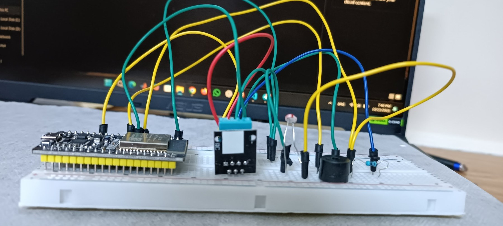
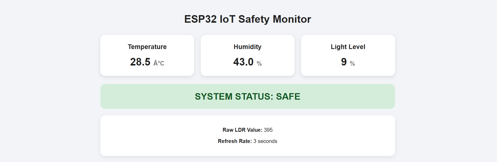

# ESP32 IoT Safety Monitor

A beginner-to-intermediate ESP32 IoT project built with the Arduino framework through PlatformIO.

The system monitors temperature, humidity, and ambient light, serves a web dashboard directly from the ESP32, and activates a buzzer when the temperature reaches the configured alarm threshold.

## Features

- Temperature monitoring with DHT11
- Humidity monitoring with DHT11
- Ambient light monitoring with an LDR
- Temperature-based buzzer alarm
- Wi-Fi connectivity
- ESP32-hosted web dashboard
- Automatic dashboard refresh every 3 seconds
- Raw LDR ADC reading
- No LCD required

## Hardware

| Component | Connection |
|---|---|
| DHT11 DATA | GPIO 33 |
| LDR sense point | GPIO 32 |
| Buzzer + | GPIO 25 |
| DHT11 VCC | 3.3V |
| DHT11 GND | GND |
| LDR supply | 3.3V |
| LDR divider resistor | GPIO 32 → GND |
| Buzzer - | GND |

### Prototype



*ESP32 DevKit on a breadboard with the DHT11 module, LDR, and buzzer.*

### LDR circuit

```text
ESP32 3.3V
    |
   LDR
    |
    +-------- GPIO 32
    |
   resistor
    |
   GND
```

The prototype uses the resistor available during testing. A resistor around 10kΩ is commonly preferable for an LDR divider, followed by calibration for the specific LDR.

## Project Structure

```text
ESP32-IoT-Safety-Monitor/
├── platformio.ini
├── README.md
├── .gitignore
├── dashboard-preview.png
├── images/
│   └── hardware-setup.jpg
└── src/
    └── main.cpp
```

## Software

- PlatformIO
- Arduino framework
- ESP32 DevKit
- Adafruit DHT Sensor Library
- Adafruit Unified Sensor

## Setup

1. Open the project in VS Code with PlatformIO.
2. Open `src/main.cpp`.
3. Replace:

```cpp
const char* ssid = "YOUR_WIFI_NAME";
const char* password = "YOUR_WIFI_PASSWORD";
```

with your Wi-Fi credentials.
4. Build and upload to the ESP32.
5. Open the PlatformIO Serial Monitor at `115200`.
6. Wait for the ESP32 to print its IP address.
7. Open that IP address in a browser on a device connected to the same Wi-Fi network.

Example:

```text
http://192.168.1.105
```

## Dashboard

The dashboard displays:

- Temperature
- Humidity
- Relative light level
- Raw LDR ADC value
- System status



## Alarm Logic

The current alarm threshold is:

```cpp
temperature >= 40.0
```

When the threshold is reached, the buzzer turns on and the dashboard changes to `ALERT`.

Otherwise, the system remains `SAFE`.

## Light Level

The light percentage is currently a relative value mapped from the ESP32 ADC range:

```text
0–4095 → 0–100%
```

It is not a calibrated lux measurement. The LDR can be calibrated later using measured lighting conditions.

## IoT Architecture

```text
DHT11 + LDR
     ↓
   ESP32
     ↓
   Wi-Fi
     ↓
Web Dashboard
```

The current version uses a local web server on the ESP32 and does not require a cloud service or MQTT broker.

## Future Improvements

- MQTT communication
- Historical data storage
- Real-time charts
- Configurable thresholds
- Flame sensor integration
- Remote alarm control
- Cloud dashboard
- Better LDR calibration
- Multiple ESP32 sensor nodes

## Author

**M. Zain Kabbany**

Mechatronics Engineering | IoT | Data Analysis | Embedded Systems
